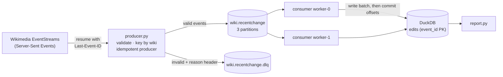

# wikistream-kafka

[](https://github.com/nschevokin/wikistream-kafka/actions/workflows/ci.yml)

A small, fully explained Apache Kafka pipeline. It streams **live edits from every Wikimedia wiki** into Kafka, consumes them with a consumer group, and lands them in **DuckDB** with **at-least-once delivery and an idempotent sink**, so crashes and replays never lose or duplicate data.

The goal is clarity over size: each Kafka concept appears once, in a place you can point to, with a demo that shows it happening.



## Quickstart

Needs Docker, Python 3.11+ and `make`.

```bash
make install          # virtualenv + dependencies
make up               # single-node Kafka (KRaft) in Docker
make produce          # stream 5,000 live edits into Kafka (LIMIT=20000 for more)
make consume          # Kafka -> DuckDB; stops after 10 s with no new messages
make report           # what landed: top wikis, bot share, rows per partition
make down             # stop Kafka and delete its data
```

## Demos

Each demo shows one behaviour you would otherwise only read about.

| Command | What you see | Concept |
|---|---|---|
| `make consume-2` | Logs show which partitions (0–2) each worker is **assigned**; together they cover all three, never sharing one. If one worker joins after the other, you also see a **rebalance**: partitions revoked and reassigned | Consumer groups and rebalancing |
| `make lag` | Per partition: committed offset, log-end offset and **lag** for the group | Offsets and lag |
| `make produce LIMIT=2000`, then `make crash-demo` | Run 1 writes a batch and dies before committing. Run 2 is handed that uncommitted batch again and logs it as `already stored`: no duplicates. The demo pauses 10 s between runs because Kafka only reassigns a dead consumer's partitions after its session timeout (set to 6 s here; the default is 45 s) | At-least-once + idempotent sink |
| `make replay` | The group is rewound to offset 0 and re-reads everything: every batch reports `0 new` | Replay is safe |
| `.venv/bin/python -m wikistream.producer --file tests/data/sample_events.jsonl`, then `make dlq` | Broken events on the dead-letter topic, each with an `error` header | Dead-letter queue |

## Kafka concepts, and where they live in the code

| Concept | Where | Why it is done this way |
|---|---|---|
| **Topics and partitions** | `producer.ensure_topics` | Topics are created explicitly with 3 partitions instead of relying on broker auto-creation, so partitioning is a deliberate choice. |
| **Message keys and ordering** | `producer.route` (key = `wiki`) | Kafka hashes the key to choose a partition. All edits to one wiki land in one partition and stay in order; different wikis spread out so consumers can work in parallel. |
| **Idempotent producer** | `producer.build_producer` | `enable.idempotence` + `acks=all`: retries after a network error cannot create duplicates, and a message counts as sent only once all in-sync replicas have it. |
| **Batching and compression** | `linger.ms=50`, `lz4` | The producer waits up to 50 ms to send messages in compressed batches, trading a little latency for much higher throughput. |
| **Dead-letter topic** | `producer.route` | Invalid events are kept with the reason in a header, not dropped and not allowed to crash the pipeline. |
| **Consumer groups** | `consumer.build_consumer` | All workers share `group.id`, so Kafka gives each partition to exactly one of them. |
| **Manual offset commits** | `consumer.run` | Auto-commit is off. Order is *write batch → commit offsets*. A crash between the two causes redelivery, never loss. |
| **Idempotent sink** | `sink.DuckDBSink.write` | `event_id` is the primary key and inserts use `ON CONFLICT DO NOTHING`, so redelivered messages are harmless. At-least-once + idempotent writes = effectively-once results. |
| **`auto.offset.reset=earliest`** | `consumer.build_consumer` | A brand-new group starts from the beginning of the topic instead of only seeing new messages. |

The upstream source matters too: `sse.py` tracks the `id` of each Server-Sent Event and reconnects with `Last-Event-ID`, so a dropped connection resumes where it left off. Wikimedia's synthetic *canary* events are filtered out.

## A finding: key choice and hot partitions

Keying by `wiki` keeps every wiki's edits in order, but it makes the load uneven. In a 9,000-edit run, `make report` showed partition 0 holding 4,630 rows and partition 2 only 850, because a handful of very busy wikis (Wikimedia Commons alone was 3,718 edits) each hash to a single partition. This is the classic hot-key trade-off: the key that gives ordering also concentrates traffic. If per-wiki ordering didn't matter here, keying by `event_id` (or no key) would spread the load evenly. I kept `wiki` because ordering within a wiki is the property worth preserving, and the report makes the cost visible.

## Delivery guarantees, in one paragraph

Kafka offers at-most-once (commit before processing), at-least-once (commit after processing) and exactly-once (transactions, for Kafka-to-Kafka pipelines). Writing to an external database cannot join a Kafka transaction, so this project uses **at-least-once** and makes the database write **idempotent**. The unit test `test_crash_before_commit_redelivers_without_duplicates` proves the claim with an in-memory model of a partition, and the integration test checks the same flow against a real broker.

## Tests

```bash
make test        # 21 unit tests, no broker needed
make typecheck   # mypy --strict
make up && make e2e   # end-to-end against the local broker
```

CI runs the unit tests and type checks, then starts a real Kafka broker as a service container and runs the end-to-end test.

## Project layout

```
src/wikistream/
  config.py      settings (all overridable by environment variables)
  sse.py         Server-Sent Events client with resume
  events.py      event model + validation
  producer.py    SSE -> Kafka (keys, idempotence, dead-letter topic)
  consumer.py    Kafka -> DuckDB (consumer group, commit-after-write)
  sink.py        idempotent DuckDB writer + per-minute view
  report.py      summary queries
tests/           unit tests with in-memory fakes, plus one integration test
```

## What would change in production

- **Replication**: replication factor 3 and `min.insync.replicas=2`, so `acks=all` survives a broker failure.
- **Schemas**: Avro or Protobuf with a schema registry instead of JSON, so producers cannot silently break consumers.
- **Rebalance handling**: commit processed offsets in the `on_revoke` callback to cut redelivery during rebalances (the idempotent sink already makes it safe).
- **Sink**: DuckDB allows one writer process, which is why the workers here are threads in one process. A real deployment would write to a warehouse or object storage, or use Kafka Connect.
- **Monitoring**: alert on consumer lag and on dead-letter topic growth.

## Data source

[Wikimedia EventStreams](https://wikitech.wikimedia.org/wiki/Event_Platform/EventStreams_HTTP_Service), `recentchange` stream: public, no account needed. The producer sends a descriptive User-Agent as Wikimedia's API policy asks.

## License

MIT
